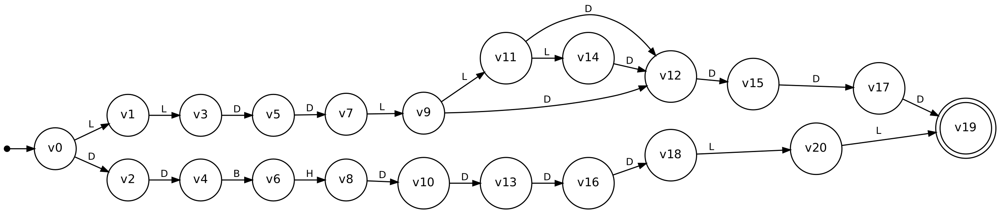
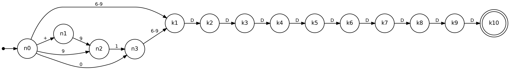
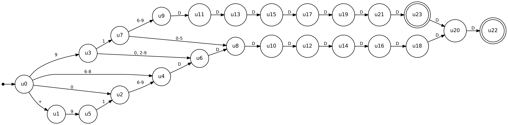
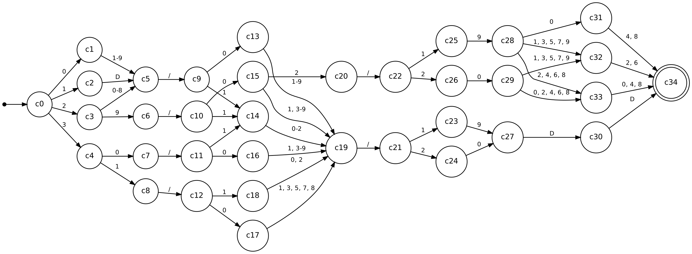

# Finite Automata for Real-Time Input Validation

**Course:** 21CSC301T Formal Language and Automata — CLA-2, Assessment Task 2
**Student:** Shanmugapriyan J (RA2411026050011), B.Tech CSE (AI & ML), III year
**Faculty:** Dr. C. Gunasundari, Department of AIML, SRM IST Tiruchirappalli

Three input fields that Indian web and mobile forms check every day, each modelled as a finite automaton,
built in Python with a small hand-written library (`fa_lab/automata.py`: DFA, NFA, subset construction,
union, trim, minimisation) and tested against independent rules.

| # | Application | Construction | States |
|---|---|---|---|
| 1 | Vehicle registration number (`TN 45 AB 1234`, `22 BH 1234 AA`) | union of two DFAs → NFA → subset DFA → minimal DFA | 12 + 11 → 24 → 22 → **21** |
| 2 | Mobile number for OTP login (`+91`, `91`, `0` prefixes) | hand-written NFA that guesses the `91` prefix → subset DFA | 14 → **24** (already minimal) |
| 3 | Date of birth `DD/MM/YYYY`, years 1900–2099 | finite language → trie → minimal DFA, with growing calendar rules | shape 11, ranges 15, months 22, leap years **35** |

## Run it

```bash
pip install pytest                              # only for the tests
python -m fa_lab.cli                            # accept/reject table for every application
python -m fa_lab.cli mobile "+91 98765 43210"   # one string with the full δ-trace
python -m fa_lab.cli date 29/02/1900
python -m fa_lab.cli --stats                    # state counts of every design
python -m pytest -q                             # 16 tests, ~35 s
python tools/make_diagrams.py                   # rebuild diagrams + browser demo (needs Graphviz)
```

**Browser demo:** open `docs/index.html`, pick an application and type. The current state is
highlighted on the diagram and every transition is listed.

## 1. Vehicle registration number

* Σ = {A, B, H, D, O}: `B` and `H` are separate classes because the BH series needs those exact letters;
  `A` is any other letter, `L` in diagrams means "any letter" (A, B or H).
* L = L_state ∪ L_BH, with L_state = L L D D L{1,3} D D D D and L_BH = D D B H D D D D L L.
* A lexer step (upper-case, drop spaces and `-`) runs before the automaton.



The first symbol (letter or digit) already decides the branch, so the subset construction produces no
mixed subsets; minimisation then merges the two accepting end states. Checking that the first two
letters are a real state code (TN, KA, …) is still regular, but needs raw letters and grows the machine to 37 states.

## 2. Mobile number (OTP login)

After `9` the machine cannot know whether the user is typing the prefix `91` or the number itself
(`9198765432` is a valid 10-digit number, `919876543210` is prefix + number). The NFA guesses:



The subset construction keeps both guesses alive as pairs such as {k2, n3} and then {k_i, k_{i+2}}, so 14
NFA states become 24 DFA states, and none can be merged.



## 3. Date of birth

The set of valid dates from 1900 to 2099 is finite (73 049 strings), so even month lengths and leap years
are regular. The trie of all dates has 82 694 states; minimisation shrinks it to 35:

| Rule set | Valid strings | Trie states | Minimal DFA |
|---|---|---|---|
| shape only, Σ = {D, S, O} | – | – | 11 |
| day 01–31, month 01–12 | 74 400 | 84 201 | 15 |
| + days per month (29 Feb always) | 73 200 | 82 845 | 22 |
| + leap years | 73 049 | 82 694 | 35 |



## Tests

`tests/test_validators.py` compares each automaton with a regex or with Python's `datetime`:
all 1 398 101 strings of length ≤ 10 over {K, B, H, 7} for plates, all 4 782 968 strings of length ≤ 13 over
{0, 1, 9} (with and without `+`) for mobile numbers, every date from 1900 to 2099 plus a 192 000-string
DD×MM×YYYY grid, and 140 000 randomly mutated inputs. NFA, subset DFA and minimal DFA are also checked to agree.

## Layout

```
fa_lab/automata.py     DFA / NFA library
fa_lab/validators.py   the three applications
fa_lab/labels.py       readable edge labels for diagrams
fa_lab/cli.py          command-line demo
tests/                 pytest suite
tools/                 diagram + web-demo generator
docs/                  diagrams (dot/svg/png) and index.html demo
```
